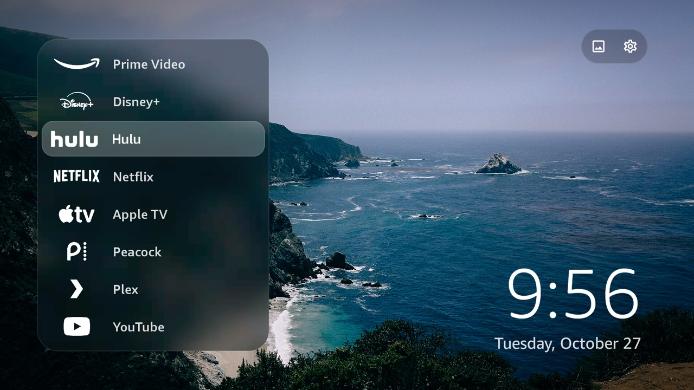
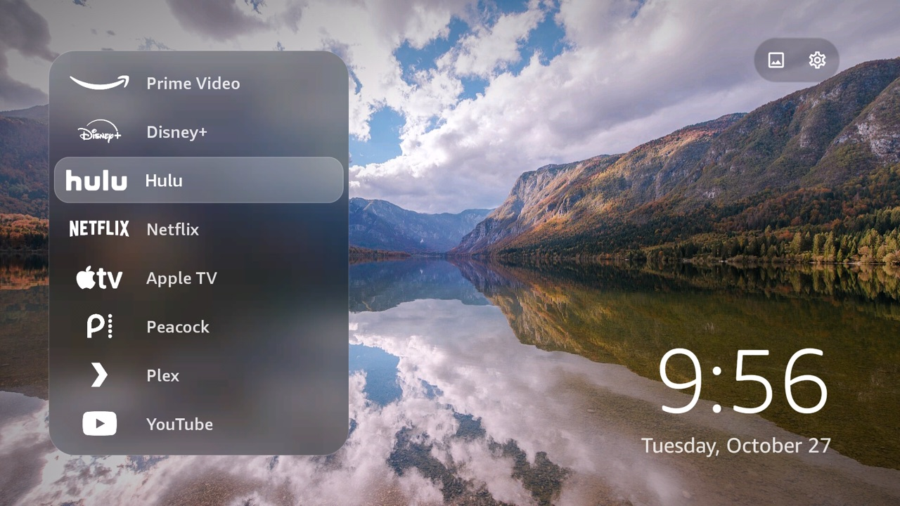
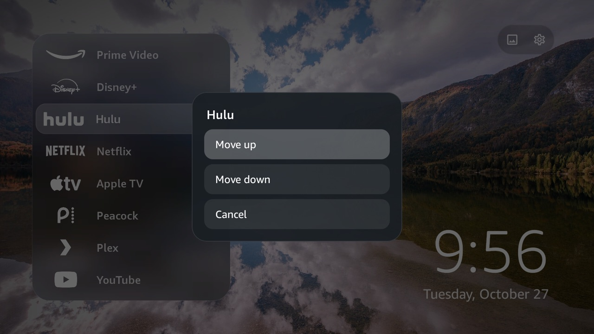
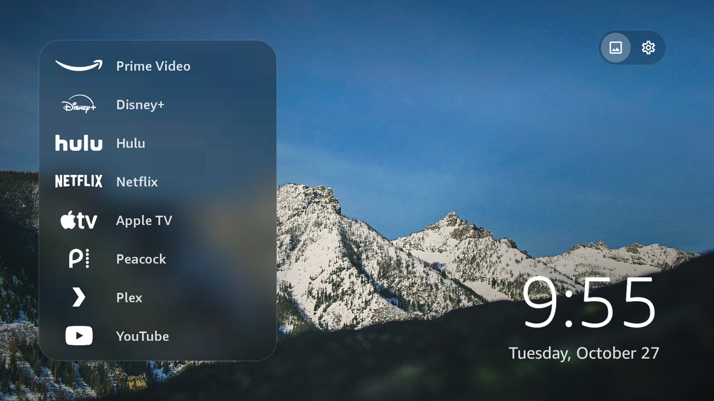
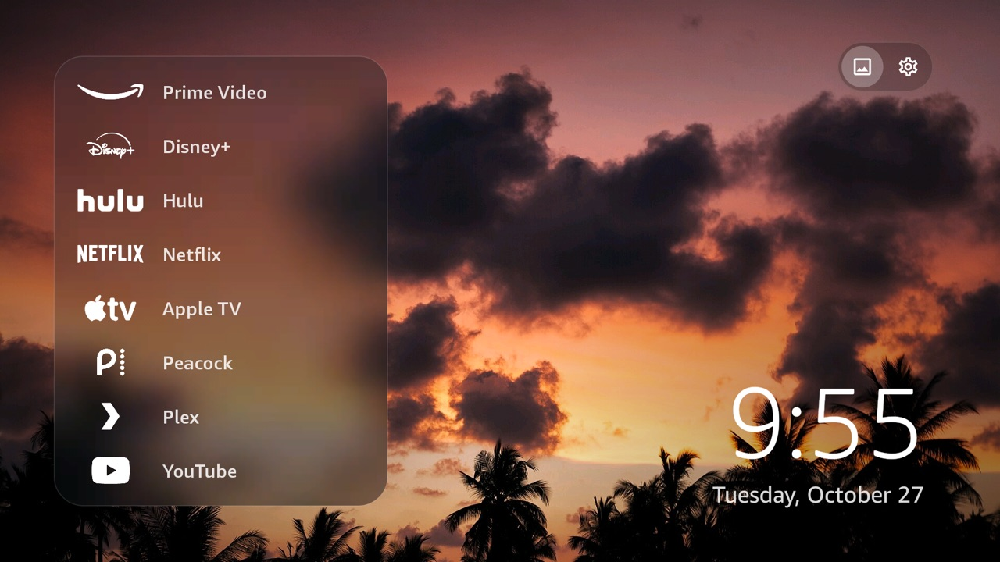
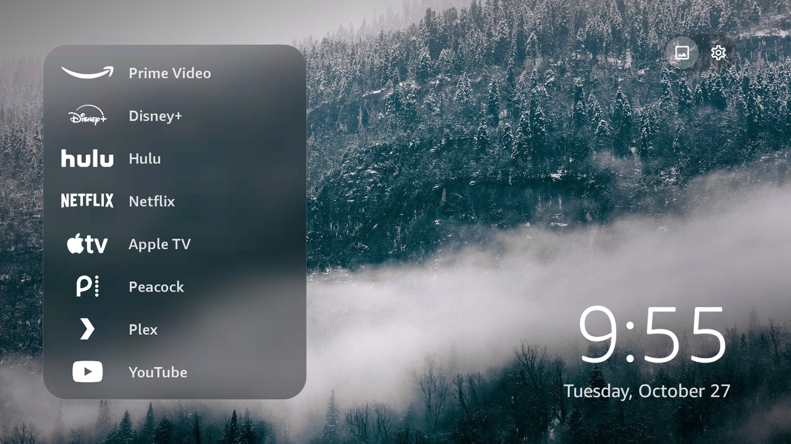

# TV Home

**A clean, simple home screen for the Fire TV Stick 4K.**


-3DDC84?logo=android&logoColor=white)




I built TV Home because I wanted my Fire TV to open straight to the apps I actually use. It replaces Amazon's home screen as my main menu with one list of my streaming apps, a photo wallpaper, and a big clock. That is it.

It is written in Kotlin with Jetpack Compose, and it runs on the Fire TV Stick 4K (2nd gen) with Fire OS 8.

## What it does

- Shows your streaming apps in one list: Apple TV, Disney+, Hulu, Netflix, Peacock, Plex, Prime Video, and YouTube.
- Turns each app's own icon into a clean white logo, so the list looks like one set.
- Opens automatically when the TV turns on.
- Comes back when you press Home, in about half a second.
- Lets you move apps up or down with the Menu (☰) button. It remembers your order.
- Does nothing when you press Back, so you cannot fall out of it by accident.
- Comes with five photo wallpapers, and you can add your own.
- Has a Settings button that opens the normal Fire TV settings.

## Screenshots

These were all taken on my Fire TV Stick.

<table>
  <tr>
    <td width="50%" align="center"><b>Mirror lake wallpaper</b></td>
    <td width="50%" align="center"><b>Menu (☰) on an app</b></td>
  </tr>
  <tr>
    <td width="50%"></td>
    <td width="50%"></td>
  </tr>
</table>

<table>
  <tr>
    <td width="33%" align="center"><b>Alpine</b></td>
    <td width="33%" align="center"><b>Sunset</b></td>
    <td width="33%" align="center"><b>Misty forest</b></td>
  </tr>
  <tr>
    <td width="33%"></td>
    <td width="33%"></td>
    <td width="33%"></td>
  </tr>
</table>

## Using the remote

| Button | What it does |
|---|---|
| Up / Down | Move through the apps |
| Select | Open the app |
| Menu (☰) | Move the app up or down in the list |
| Right, or Up from the top app | Go to the wallpaper and Settings buttons |
| Home | Come back to TV Home from any app |
| Back | Nothing on the home screen |

## Install it

You need a computer with [adb](https://developer.android.com/tools/releases/platform-tools) installed.

1. On the TV, go to **Settings → My Fire TV → Developer options** and turn on **ADB debugging**.
2. Find your stick's IP address in **Settings → My Fire TV → About → Network**.
3. Download `TV-Home-v1.0.apk` from the [latest release](../../releases/latest).
4. Connect to the stick. A pop-up will ask you to allow debugging on the TV. Check **Always allow from this computer** and select **OK**.

   ```bash
   adb connect <stick-ip>:5555
   ```

5. Install TV Home and give it the permissions it needs:

   ```bash
   adb install -r TV-Home-v1.0.apk
   adb shell cmd package compile -m speed -f com.tt.tvlauncher
   adb shell pm grant com.tt.tvlauncher android.permission.WRITE_SECURE_SETTINGS
   adb shell pm grant com.tt.tvlauncher android.permission.READ_EXTERNAL_STORAGE
   adb shell appops set com.tt.tvlauncher SYSTEM_ALERT_WINDOW allow
   adb shell settings put secure enabled_accessibility_services com.tt.tvlauncher/com.tt.tvlauncher.HomeButtonService
   adb shell settings put secure accessibility_enabled 1
   adb shell am start -n com.tt.tvlauncher/.MainActivity
   ```

The `compile` line makes scrolling smooth. The `WRITE_SECURE_SETTINGS` permission lets TV Home turn its Home button helper back on if Fire OS switches it off.

## Add your own wallpapers

Copy a photo to the stick, then press the wallpaper button on the home screen. Your photos show up before the built-in ones.

```bash
adb shell mkdir -p /sdcard/Pictures/TVHome
adb push my-photo.jpg /sdcard/Pictures/TVHome/
```

## How it works

Fire OS 8 does not let you pick a different home screen, so TV Home uses two workarounds.

- **`HomeButtonService`** is an accessibility service. It watches for Amazon's home screen to show up, which happens every time you press Home, and puts TV Home back on top. Opening Fire TV Settings also passes through Amazon's home screen for a moment, so the service knows to leave that alone.
- **`BootReceiver`** opens TV Home when the stick starts. It also turns the accessibility service back on, because Fire OS turns it off whenever the app is force-stopped.

I also worked to keep it fast and light. The stick only has 1.7 GB of memory, so TV Home paints the wallpaper and the glass panel into one image ahead of time. Because of this, it uses about 74 MB, and moving through the list takes about 6 ms per frame.

## Build it yourself

You need JDK 17 and the Android SDK (platform 35).

```bash
./gradlew assembleRelease
```

The APK ends up in `app/build/outputs/apk/release/app-release.apk`.

## Getting back to Amazon's home screen

This command turns off the Home redirect until TV Home opens again or the stick restarts:

```bash
adb shell settings put secure enabled_accessibility_services null
```

## Known limits

- When you press Home, Amazon's home screen may flash for a moment before TV Home comes back. Fire OS always opens it first.
- The mic button on the remote cannot be turned off. Fire OS handles it before any app sees it.
- There is no search bar. Fire TV's own search only works for Amazon's apps.

## Credits

All five wallpapers come from Wikimedia Commons (first posted on Unsplash) and are free to use under CC0: "Rocky coastline at Big Sur, CA," "Clouds mirrored in a mountain lake," "Alpine landscape," "Colorful sky during sunset," and "Cloud over a forest."

App names and logos belong to their companies. TV Home does not include them. It reads each app's icon from the stick.

## License

MIT. See [LICENSE](LICENSE).
